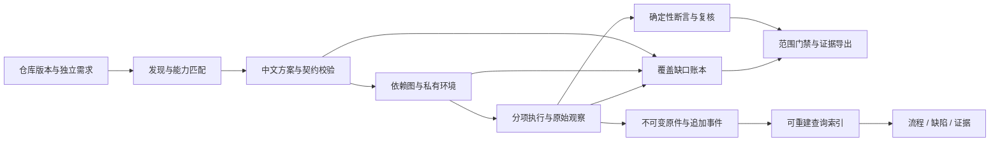

# D042 · 开源成熟度改善方案

日期：2026-10-31。状态：设计方案，尚未实施。适用范围：单机自托管的开源验收工具。

本方案延续 D041 的真实执行、独立依据、不可变证据和追加复核机制。目标是达到可供外部开发者安装、使用和贡献的可信 Alpha，再以独立评测和运行稳定性达到 Beta；不以扫描器数量、测试通过数量或“任意仓库必定通过”作为成熟度指标。

## 1. 当前事实与改善目标

当前判断：有实际能力的工程 Alpha，尚不具备成熟开源版本的交付条件。

2026-10-31 核验的 D041 结果如下。Fastify 使用同版追加复跑；原网络失败记录保留。

| 仓库 | 验收记录 | 业务通过 | 业务失败 | 业务异常 | 门禁 |
| --- | --- | ---: | ---: | ---: | --- |
| Flask | int-364f0c4ce50b4ef8 | 68 | 3 | 14 | inconclusive |
| Fastify | int-9ebeca89d0194c8d | 16 | 1 | 2 | inconclusive |
| sqlite-utils | int-fe2b255558a6465f | 64 | 6 | 2 | inconclusive |

合计 176 条业务用例，148 通过、10 失败、18 异常。失败不全部代表被验收项目缺陷，异常也不全部代表平台错误，需要逐项归因。这一批 r6 复验使用充值后 r4 的 32 批模型原件，不是再次调用模型；两个旧请求继续保留未知。

已有 Redis/Celery/Web、真实浏览器业务、独立用例环境、离线 Python 夹具、证据校验和 OPA 门禁；714 项后端、37 项前端回归是平台回归证据，不是识别准确率或全新机器安装成功率。历史目录逐份检查原件导致冷启动慢，详情曾超时；已恢复服务，不等于根因全部消除。

本次再次检查工作区：尚无 Git HEAD 和远端，根目录缺少许可证、贡献说明、安全报告说明和发布 CI；当前目录还混有其他项目，不能整体上传。README 与历史能力说明需要整理，干净机器上的当前完整版安装仍需验证。

上述事实以 [D041 交付与证据](https://knowledge.110-lab.cn/p/hhPLN1HvFZ) 和本地 `docs/design/d041/r6-交付结果与剩余边界.md` 为依据。下面所有数量、性能和准确性指标均为拟定验收目标，不是已实现成绩。

## 2. 先固定产品承诺

正式定位：读取仓库及独立需求，设计可核对的中文验收方案，在隔离环境中执行适用检查，区分项目问题与验收过程问题，并提供可复核的结论和证据。

输入包括仓库版本、需求/接口契约、范围和执行策略；输出包括需求覆盖账本、版本化方案、分项执行结果、缺陷复核、门禁及证据包。

### 2.1 通用能力不等于无条件全自动

任意仓库可以进入发现流程；实际执行能力由语言、接口、运行环境、依赖服务和独立依据共同决定。支持矩阵必须描述这些组合，并区分“经过实仓验证”“实验性”“仅可导入报告”“尚未支持”。仅识别到技术栈不算支持。

不得按 Headroom、Flask 或其他仓库名称分派新执行配方。已有历史配方保留读写兼容，新能力进入统一协议。允许读取项目已有的标准清单、启动声明和迁移命令；缺失时可以提出带来源的配置建议。配置表达入口、变量和前提，不包含绕过失败的专用脚本或改写业务预期的逻辑。

默认流程自行完成发现、可确定的环境准备和可执行检查。确实缺失业务标准时只影响相应验收义务，其他检查继续；最终不能据此声称全范围通过。

### 2.2 四种信息分开记录

| 维度 | 回答的问题 | 例子 |
| --- | --- | --- |
| 执行状态 | 任务执行到哪里 | 排队、运行、已结束、取消、中断 |
| 覆盖状态 | 这项需求是否得到有效验证 | 已验证、缺依据、缺环境、平台未支持、事先排除 |
| 发现判定 | 观察结果说明什么 | 待复核、已确认缺陷、工具误报、非缺陷、用例问题 |
| 门禁结论 | 在哪个范围内允许放行 | 通过、拒绝、无法下结论，附范围及策略版本 |

缺陷使用 P0–P3 展示处置优先级，另保留扫描器原始严重度和转换依据；优先级不替代确认状态。正常测试中的 assert 属于核对后可排除的非缺陷，不把所有规则命中笼统叫作“工具误报”。

有已确认且命中门禁的缺陷时可以明确拒绝，同时展示覆盖不足；没有确认阻断项但存在必需项缺口时无法下结论。通过必须绑定已声明范围、有效证据和策略。事先排除的真实邮件等生产副作用不生成用例，不计为通过；执行后的失败不得靠改成排除项消失。

### 2.3 独立依据与实现信息分开

业务预期来自用户确认的需求、合同式 API 规范或可引用的公开行为承诺。README 可以提供承诺，但应标注其与实现同源的局限。源码允许用于发现导出接口、参数、依赖与定位器，不得用被测程序的实际输出反推正确答案。

自动从代码提炼出的说明标记为“实现推断”，不能自动升级为独立验收标准。第二个模型的同意也不能代替独立依据或真实复现。需求覆盖的分母是冻结的验收义务，不能由模型只生成容易执行的几条用例来缩小。

## 3. 总体架构：保留现有系统，补齐边界

保留 FastAPI、现有 React 界面、SQLite/Huey、执行器注册表、Playwright、OPA 和原件存储。不为单机工具增加 Kubernetes、Kafka 或多租户服务。本阶段的自研集中在需求溯源、统一执行协议、错误归因、复核与门禁语义。

## 4. P0：先保证结论不会失真

### A01 · 统一结果契约和覆盖账本

**改动**：在现有模型与门禁上增加统一的版本化结果封装，包含 requirement_id、case_id、attempt_id、输入/依据/工具摘要、执行状态、覆盖原因、发现状态及证据引用。失败原因使用稳定枚举，中文解释另存，避免靠英文报错字符串决定缺陷类别。

原因至少包含：缺少依据、环境准备失败、平台不支持、工具异常、模型服务异常、用例契约错误、业务断言不符、执行被取消。无法确定时保持待复核，不强行二选一。

**代码位置**：`acceptance/universal/models.py`、`coverage.py`、`acceptance/integrations/models.py`、`adjudication.py`、`gates.py`、`gates.rego`。旧记录通过兼容读取器解释，不批量回写原件。

**验收**：无报告、空报告、损坏报告、缺失必需检查、工具崩溃、上游未知、原件篡改等负例均不能产生通过；同一原件在 CLI、API 和三个页面中计数一致。先冻结反例库，再改实现。

### A02 · 建立可量化的正确性评测

**改动**：建立独立于执行器单元测试的标注集，覆盖有效通过、真实违规、正常测试 assert、用例错误、依赖故障、部分报告、未知模型响应、重复发现和证据篡改。每个样本保存预期判定及其独立理由。

评测分开发集和留出集，按仓库/场景家族拆分；不得随机拆同一场景的近似变体来冒充泛化。现有三个仓库属于已反复调试的开发证据，不能继续充当唯一留出集。

第一批目标至少 100 个标注检查点，其中真实违规与明确非缺陷各至少 30 个，其余覆盖工具、环境、用例和证据异常；发布分类型混淆矩阵、分子分母和未判定数。已确认缺陷精确率目标至少 95%，但样本不足时不报可靠的整体百分比；保留置信区间及类别分布。召回率只在已知真值的样本上计算，不能估算未知仓库的“漏洞检出率”。同时报告自动确认比例和转人工比例，不能靠把所有结果都列为待复核来取得好看的精确率。

**验收**：对冻结负例集错误放行数为 0；有限样本的 0 不宣传为普遍零漏报。工具误报和正常 assert 不增加已确认缺陷；同一问题的重复报告保留来源与出现次数，不能仅按标题合并掉不同位置或影响。

**独立性**：实仓不改源、不改原测试；需要可控正反例时使用单独的公开基准夹具或已知历史版本，明确不算被验收项目的修复。

## 5. P0：把长时间运行和页面读取做稳定

### A03 · 历史索引与证据校验解耦

当前 `IntegrationStore.list()` 遍历历史运行的原件、源码和驱动文件；缓存失效时调用完整 snapshot/verify。应新增可重建的 SQLite 元数据索引，保存仓库、提交、状态、分项计数、最近事件和校验时间。

列表、筛选和搜索走游标分页；详情按区块和原件分页读取，日志/大文件继续流式处理。迁移时后台建立索引，显示导入进度，不悄悄丢弃旧记录。只对选定原件或最终复核任务执行相应强度的校验。

索引中的“上次校验通过”必须带时间及摘要，不能当成当前全量已验证。用于新的 CI 放行、证据导出和重新复验的输入仍须完整核对；耗时核验作为独立任务执行，不能通过跳过校验换取性能。索引损坏可由原件重建，不能反向修改原件。

**代码位置**：`acceptance/integrations/store.py`、`storage.py`、`acceptance/api.py`、前端记录/仓库列表。继续使用单机 SQLite；WAL 数据目录要求本地文件系统，不放网络共享盘。[SQLite WAL 文档](https://www.sqlite.org/wal.html)

**验收目标**：固定并公布硬件、存储和查询条件；用 1,000 与 10,000 条基准记录测试索引分页，已建索引的首屏 API p95 < 1 秒；冷索引重建单独计时。10,000 是测试规模，不是产品上限。复核同时进行时，健康、列表和任务状态仍可读；篡改原件后再次验证必须失败。

### A04 · 任务恢复、取消与模型调用账本

沿用 Huey/SQLite 队列与现有模型回执机制，补齐统一任务租约、心跳、状态迁移和恢复诊断。模型、准备、业务、归档分别记录耗时，不能把排队混成执行耗时。

取消须停止本任务进程/容器并回收自有资源；宿主重启或 worker 中断后保留 interruption 事件。确定失败且可安全重试的依赖下载创建新 attempt，并保留旧错误；业务重跑必须从私有基线开始。未知模型请求不能自动重新付费调用，也不能因为本地超时就标为供应方失败或取消成功。

新增模型可用性预检、费用/令牌/时间预算展示与可恢复批次索引，复用现有 `model_budget.py` 和 `calls.py`。恢复时只有输入、依据、模型设置、工具链及原件一致的已完成步骤可复用，页面明确标明复用来源。支持安全的局部重试，但最终报告必须交代各次尝试，不拼出从未发生过的“全新完整运行”。

**验收目标**：至少 20 个阶段故障注入点覆盖入队、模型等待、容器启动、产物落盘、归档和清理；不丢记录、不重复隐式调用模型、不串用例状态。取消受控本地任务后 30 秒内停止其计算；回收较慢则明确显示“清理中”，不得伪称完成。未知的远端请求单独保留。24 小时持续运行无持续性内存增长、不可恢复队列卡死或自有资源泄漏。

**规模原则**：不增加仓库文件数、体积、报告条数或用例总数硬上限；采用分片、分页、队列背压和续跑。单次并发、内存、磁盘、水位、超时及费用仍须可配置，否则“无限大小”会变成宿主失控；触及预算时给出真实中断与恢复点，不静默截断。

## 6. P1：提高中文用例的有效性

### A05 · 用例进入执行前经过分层校验

保留模型设计，增加统一的准入链：来源可核对 → Schema 完整 → 接口/参数绑定 → 环境前提 → 可观察结果 → 独立断言 → 执行。每个拒绝项定位到具体用例和字段，其他用例继续。

1. **来源层**：中文标题、步骤和解释；引用保留原文及位置。原文不存在、来源冲突或缺少承诺，进入缺依据，不由模型自行补写。
2. **接口层**：核对实际公开函数、CLI 参数、对象/字典差异、异步回调、HTTP 响应包装层和 JSON Pointer；实现信息仅用于可调用性，不决定正确预期。
3. **状态层**：声明数据库、用户、文件、服务就绪及生命周期；禁止依赖上条用例留下的数据。
4. **浏览器层**：优先语义角色、名称、label 等可观察定位；有多个候选时报告歧义，不静默使用第一个。保留等待条件与最终业务结果断言。[Playwright 定位器文档](https://playwright.dev/docs/locators)
5. **比较层**：JSON、CSV、数据库结果先按契约选择结构比较；字符精确匹配仅用于确实承诺字节/格式的场景。空字符串与 null、行顺序、SQL 语义等不能无依据归一化。

**用例修正机制**：错误定位器、参数或返回路径可以生成修订建议；仅来源唯一且不改变业务预期的机械修正允许自动生成新版本。涉及业务语义、容差或断言变化则等待复核。保留 v1 失败、修正理由、差异和 v2 新执行，禁止根据实际结果修改 expected。自动修正有明确次数/费用预算，不能无限自修到绿。

**代码位置**：`acceptance/planning/{models,compiler,citations,verification}.py`、`acceptance/universal/{generation,bindings,scenario,journeys,browser_runtime}.py`。

**验收**：D041 的多定位器、响应层级、属性映射、格式过强和夹具依赖问题均有可复现的通用正反例；修正能消除平台/用例错误，也能在确实违反业务契约时保持失败。不能只检查修正后的通过样例。

### A06 · 缺陷确认有明确证据门槛

继续复用已有观察归纳、AST 降噪、精确去重和追加式人工复核。增加每条结论的证明义务：违反哪项标准、前置条件是否成立、输入与观察是否完整、是否可复现、工具/用例自身错误是否被排除。

确定性的契约断言在基线和工具有效时可形成已确认结论；静态规则命中或模型推测默认候选。自动复现要保留版本和回执；“未复现”不直接等于误报。矛盾证据降为待复核并说明原因，不能覆盖旧结论。P0/P1 高影响结论在对外报告前需要完整证据与复核。

补充跨运行的稳定问题身份、首次/最近出现、修复后复验和重现。复核决定可以随证据追加；历史门禁保持原样，当前门禁按新策略生成新版本。已有 DefectDojo/ReportPortal 接入继续用于交换，不自建一套重复的企业缺陷管理系统。

**验收**：相同问题重复导入计数稳定，位置/上下文不同的问题不误合并；正常 assert 不成缺陷；平台异常单独计数；已修复后重现能回到待处理且保留前史。

## 7. P1：补齐真正可泛化的状态与多服务执行

### A07 · 一份声明式服务契约贯穿发现到清理

统一描述：服务类型、固定镜像、来源、依赖、临时凭据、就绪条件、迁移命令、种子数据、状态隔离方式、业务可观察点和回收责任。读取标准清单、Compose、公开命令或用户提供的部署说明，转为平台协议；仓库文件本身不授予宿主权限。

启动顺序与“可用”分开：端口打开不能证明数据库可查询，worker 存在不能证明消息消费。Compose 的依赖健康条件可以复用，但需转换并审查，不直接执行任意仓库的整个 Compose 文件。[Docker 启动与健康依赖文档](https://docs.docker.com/compose/how-tos/startup-order/)

**优先补齐的组合**：

| 类型 | 已有基础 | 本批补齐 | 支持证明 |
| --- | --- | --- | --- |
| SQLite / CLI / Python 模块 | 多步调用、私有状态、插件夹具 | 初始化/迁移协议、动态依赖分类和离线复现 | 两个不同项目的状态前后核对 |
| Redis + Celery + Web | 已有真实消息与浏览器链路 | 冷启动、消费失败、隔离、恢复及重复执行 | 请求 ID、队列、worker 与最终页面闭环 |
| PostgreSQL + Web / API | 有目录项，完整契约未认证 | 临时认证、建库、迁移、种子、可用探针、每例隔离和清理 | 新复杂项目的完整流程与数据核对 |
| Node HTTP / 浏览器 | Fastify、HTTP 与 Playwright 基础 | 多组件构建、准备结果复用、会话/权限/文件传递 | 新 TypeScript 全栈项目验证 |
| MongoDB 等其他服务 | 支持证据不足 | 沿相同契约扩展，单独排期与认证 | 未实测前持续标实验性 |

迁移与种子只在本次隔离的新数据库执行，使用项目声明的入口或独立测试契约；不得连接真实生产库，不得靠修改项目代码解决兼容性。

**依赖准备**：保留标准包管理器、锁文件、下载日志、实际解析版本及镜像摘要。分别处理静态 wheel、源码构建、直接 URL、动态构建声明；后三者先在受限构建阶段验证，再产出可归档缓存。不能将一次联网安装可用说成离线可复现。涉及不明凭据时局部停止，其他分支继续。

**验收**：没有任何按新仓库名称/路径判断的分支；发现、准备、业务、清理均经普通入口执行。重复运行不继承用户、数据库或消息状态；数据库失败不阻断独立 CLI/静态检查；源文件、原生测试和锁文件前后不变。

### A08 · 完整业务、API 边界、性能与恢复

业务流程按“输入 → 状态变化 → 可观测结果”设计，覆盖成功、拒绝、权限、回滚/重试等有依据的分支。浏览器、HTTP、CLI、数据库观察共享 case/step 身份，关联截图、trace、HAR、日志和业务对象 ID。

继续使用已接入的 Schemathesis 做有契约的 API 边界与状态检查；其生成请求不能替代业务需求，自动从代码生成的 Schema 也不能升级为独立业务标准。[Schemathesis 官方说明](https://schemathesis.readthedocs.io/en/stable/)

将已有 k6 能力从历史项目配置提炼为通用负载协议，绑定运行环境、数据规模、预热、并发及阈值。无独立 SLO 时只输出观测值，不宣称性能达标。[k6 阈值文档](https://grafana.com/docs/k6/latest/using-k6/thresholds/)

恢复验证拟复用 Toxiproxy 的网络故障注入，结合受控进程重启验证恢复时间、数据一致性及重复副作用；故障域和断言必须来自独立需求。仅容器重启成功不能算恢复成功。[Toxiproxy 官方仓库](https://github.com/Shopify/toxiproxy)

真实外发邮件、真实支付、外部身份等按既定策略排除；有独立替身契约时可测本地边界，但明确不证明真实第三方交付。避免为了覆盖率临时放开生产副作用。

## 8. P0/P1：成为别人能安装和维护的开源软件

### A09 · 独立发布仓库、可复现安装与贡献入口

从当前工作区按允许清单导出平台源、测试、可公开基准和文档，建立独立 Git 历史；不对整个混合工作区直接 add/上传。保留现有本地数据和历史证据，发布包不默认包含它们。

补齐当前版 README、安装/升级/故障诊断、CLI/API、支持矩阵、CONTRIBUTING、SECURITY、安全报告渠道、贡献模板、CHANGELOG 和第三方来源清单。知识库与仓库文档有同一版本和链接，历史日志不再充当当前使用手册。用户界面和模型用例保持中文；面向开源提供简明英文入口说明。

许可证在权利来源核对后确定；用户此前提供的参赛条款包含共享知识产权表述，正式发布前应核对适用版本及实际约定。本方案不代替许可决定，也不擅自给第三方代码换许可证。依赖尽量通过进程/API/标准格式接入，复制代码则保留来源与许可记录。

提供同一安装入口及 doctor 诊断：Python/Node/容器运行时、端口、磁盘、镜像、模型连接和外网策略逐项检查。已有镜像 Dockerfile 与锁文件继续使用；修正仅存在本机的镜像 ID 依赖，记录平台架构和可取得的版本/摘要。先完成 CPU 环境，无需新用户配置 GPU。

安装验证分两条：无需模型凭据的公开正反样例；用户自行配置密钥后的新模型设计与真实执行。离线重放不冒充新模型验收。模型提供方故障只影响相关设计批次，不能使静态检查或历史证据查看不可用。

**首批宿主矩阵**：Linux x86_64 与 macOS ARM64 + Docker 环境作为候选，分别在干净环境实际验证后才能标“支持”；Windows/WSL、其他架构保持未认证。不能把本机旧缓存环境的成功外推为跨平台支持。

**验收**：每个拟支持宿主至少 3 次全新安装/空数据目录运行，按公开文档完成正常样例、故障样例、结果查看、证据导出和卸载；不依赖作者绝对路径、历史容器、私有模型账户或未公开资料。至少有外部使用者能照文档完成，不由作者在背后修环境。

开源基础参考 OpenSSF 的许可、版本管理、贡献说明、文档和自动化测试要求；这不等于已经获得认证，也不把其所有高级徽章条件强加给首个 Alpha。[OpenSSF Best Practices](https://www.bestpractices.dev/en/criteria)

### A10 · 执行边界、凭据与发布链

本产品会运行仓库代码，必须把宿主、执行容器、模型和证据分享的边界写清楚。默认单用户回环访问；通用安全评估以该部署方式为范围，不宣称可以直接暴露公网或托管任意敌对代码。

执行容器不获得宿主 Docker socket、宿主家目录、真实云凭据或跨任务可写卷；下载依赖与业务执行分阶段，运行权限和外网例外可检查。现有 registry 网络模式只是允许下载阶段联网，不是域名白名单，需补足实际可验证的出网策略。先建立可执行边界测试，不靠容器名称或配置文案宣称安全。

模型输入的代码/文档范围和传输提供方在计划中可见；密钥只在凭据层读取。日志、trace、HAR 和模型响应可能携带敏感值：本地受限原件和可分享脱敏包分开，后者记录脱敏清单及自身摘要，不能伪称与原件字节相同。验证用可公开的哨兵秘密，不将真实秘密放入测试。

平台自身的 CI 复用 Gitleaks、现有静态检查和依赖检查；Syft 为发布源包/镜像生成 SBOM，保存第三方版本和来源。扫描通过不能替代许可证核对或证明没有漏洞。[Syft 官方仓库](https://github.com/anchore/syft)

当前本地摘要校验只能核对内容一致性，不能独立证明作者身份或执行环境可信。发布包增加来源、版本、校验值及可验证的构建记录；面向外部可信签名的能力另设验证，不把现有 SHA-256 包装成第三方证明。

**验收**：隔离负例不能读到测试宿主秘密、越过任务卷或改写原仓库；分享包中的哨兵秘密均被发现/阻止导出；危险运行权限被拒绝且给出中文原因。所有标“已验证”的接入项必须有退出码、报告 Schema、故障和原件保留的契约测试。

### A11 · 升级、回滚与扩展兼容

执行协议、结果格式、适配器和门禁策略分别版本化。旧报告按原解释器版本读取，升级后重新分析生成新投影和事件，不静默改写历史判定。

数据库迁移采用版本化脚本与备份，优先可增量兼容的改动。复用 SQLite 的备份能力；恢复测试必须含队列、索引、复核事件和原件引用，不能只测试数据库可打开。[Python sqlite3 备份接口](https://docs.python.org/3/library/sqlite3.html#sqlite3.Connection.backup)

回滚时新版本产生的数据封存保留，恢复旧版可读备份并只运行兼容任务；不得让旧程序直接写不兼容的新 Schema。模型在途请求和未知回执继续有归属，不能在切换版本时消失或重新发出。

插件规范定义发现、准备、运行、解析和证据接口，给贡献者提供一套通用适配器样例及契约测试。新增工具必须分别标注“已注册、解析通过、真实执行通过、实仓认证”，避免一条工具名冒充四种成熟度。

**验收**：上一支持版本 → 新版本 → 受控回滚 → 再升级，历史证据、计数、复核和未知状态均可解释；故障中断迁移可恢复。第二位开发者可按公开规范添加一个适配器并通过契约测试，无需修改主流程中的仓库判断。

## 9. 页面只补足决策所需信息

沿用已确认的三页设计，不再整体推翻视觉：

- **验收流程**：单行横向滚动，显示每阶段真实状态和耗时；展示当前动作、已完成分项、阻塞原因及局部重试。仓库、分支/提交、依据版本、模型来源和范围保持可见。执行结束与验收通过分开。
- **缺陷详情**：默认回答发生了什么、预期是什么、实际是什么、影响哪里、如何复现和为何这样分类；P0–P3 与待复核/确认等状态并列。原始工具诊断展开可见。
- **证据溯源**：按依据 → 用例版本 → 步骤 → 原始观察 → 复核 → 门禁展开；区分当前核验、历史核验和未核验，支持原件/脱敏包/trace。重跑保留清楚的前后版本关系。

前后端共享计数口径；列表分页不能改变总数。窄屏和大报告实际浏览验证，不只截图样例。复杂术语放在可展开说明中，默认界面用直接中文。

## 10. 开源组件复用清单

下表是处理方式，不是新增数量目标。已接入组件不重复宣称为新能力；实施时锁定版本并执行兼容验证。

| 能力 | 复用 | 我们负责补齐 |
| --- | --- | --- |
| 任务持久化 | 已有 Huey + SQLite | 统一状态、恢复、取消、幂等与模型未知账本 |
| 查询与索引 | SQLite 索引、事务、备份 | 目录投影、游标分页、校验时间和重建 |
| 业务执行 | 已有 Python/Node/Go 等驱动与标准包管理器 | 来源绑定、类型/状态协议与隔离环境 |
| 浏览器 | 已有 Playwright / Trace Viewer | 场景准入、可靠定位、独立结果断言和证据关联 |
| API 边界 | 已接入 Schemathesis | 与独立 Schema、会话及业务状态衔接 |
| 扫描与 SBOM | 已有 Semgrep CE、Bandit、Gitleaks、Trivy、Syft 等 | 适用性、故障识别、去重与结论认证 |
| 质量门禁 | 已有 OPA | 范围、缺口、确认状态与策略版本 |
| 缺陷/报告交换 | 已有 DefectDojo、ReportPortal 等接口 | 实际验证等级、跨运行身份和同步回执 |
| 多服务 | Docker Engine、Compose 的声明/健康语义 | 受限转换、依赖图、私有状态与清理 |
| 性能 | 已有 k6 | 通用负载协议、独立阈值与环境绑定 |
| 恢复 | 拟引入 Toxiproxy，复用容器生命周期 | 故障模型、数据一致性及副作用断言 |
| 协议校验 | 已有 Pydantic、JSON Schema 等 | 版本兼容和错误归因，保持预期独立 |

Huey 提供持久队列、锁和执行机制，但不会自动保证本产品任务的业务幂等或未知请求语义；这部分必须由平台协议与测试保证。[Huey 官方文档](https://huey.readthedocs.io/en/latest/)

## 11. 实施批次与退出条件

P0 是发布前必须具备，P1 是通用 Beta 的核心完善；优先级不意味着将有依赖的步骤全部串行等待。每批都提交方案差异、代码自审、平台回归、实仓证据及剩余边界。

| 批次 | 工作 | 主要依赖 | 完成条件 |
| --- | --- | --- | --- |
| B0：固定基线 | A01/A02 的结果语义、反例库、支持矩阵；独立发布目录与当前版文档骨架 | 无 | 当前失败可复现；覆盖与门禁口径冻结；没有公开发布私人工作区 |
| B1：先稳住运行 | A03 索引分页、A04 恢复与取消；A10 的执行边界基础 | B0 | 大目录可用、关键故障可恢复、原件仍强校验、运行边界负例通过 |
| B2：形成可信 Alpha | A05 核心用例准入、A06 分类复核；A09 干净安装与平台 CI；A11 最小数据兼容 | B0/B1 | 已声明的小范围可以独立安装、执行、复核；不足明确展示 |
| B3：扩大真实通用能力 | A07 PostgreSQL/多服务与夹具、A08 完整业务/API/性能/恢复、A05 剩余语义问题 | B2 | 新复杂仓库通过同一入口，无专用配方；真实缺陷、用例和环境问题可区分 |
| B4：Beta 认证 | 留出仓库、跨宿主、长稳、升级回滚、外部试用、扩展契约 | B3 | 发布全部基准与证据，支持矩阵按实测结果标注 |

先完成一个能可靠工作的组合，再扩展到下一个；扫描器新接入只有解决实际覆盖缺口才进入本轮。不以商业产品的所有菜单作为待办清单。多租户、SSO、分布式执行、原生移动端/硬件和生产第三方凭据不是本轮成熟度门槛。

人力按一名熟悉代码的维护者估算：可公开试用 Alpha 约 3–5 人周，达到上述 Beta 条件累计约 7–11 人周。它们是根据当前工作包规模的粗估，不是排期承诺；外部试用等待、模型余额/网络和新增服务适配会影响日历时间。B0 结束后依据实测吞吐、缺口数量和可用宿主重新估算，不为赶日期降低门禁。

## 12. 真实验证安排与发布门槛

### 12.1 三层验证，避免只在熟悉的项目上变好

1. **平台正反例**：固定输入与真值，覆盖结果判定、来源校验、状态隔离和故障恢复，每次变更先回归。
2. **既有实仓**：Flask、Fastify、sqlite-utils 固定提交完整复跑，保留旧预期、旧模型原件与旧失败；需要新设计则产生新版本，另做新模型链路实测。目标是消除平台/用例错误、准确保留产品失败，不是让三仓库全部变绿。
3. **新留出实仓**：至少三个未用于当前修复的仓库，覆盖 Python Web + PostgreSQL/迁移/权限、TypeScript 多包 Web/API/浏览器、Go 或 Rust CLI/状态持久化。候选先按公开文档、维护状态、启动条件和可冻结提交筛选，再固定；当前不声称已选定或验证。若缺合同式需求，缺口如实进入报告，不能换成更简单仓库后隐去原失败。

支持单元定义为“仓库提交 + 运行时版本 + 服务组合 + 已声明范围”。一个仓库成功不认证整个框架；复杂项目同时统计发现率、环境准备率、有效执行率、平台异常、用例问题和缺口，而不是只给总通过率。

### 12.2 Alpha 必须满足

- 有清楚的许可证/来源处理结果、独立源码仓库、贡献和安全入口、版本化发布包。
- 支持矩阵和安装步骤与真实可用能力一致；拟支持宿主干净安装及公开正反样例通过。
- 必需步骤缺失、工具异常、未知请求和证据错误均无法错误放行；没有已知会将这些状态当作通过的未修问题。
- 核心页面稳定，历史原件可读，当前三仓库问题有逐项归因与可追踪的未完成项。
- 模型来源、费用边界、复用状态和数据外发范围明确；执行隔离及分享包基本检查通过。

Alpha 可以有实验性能力和真实业务失败，但不能隐瞒它们或把适用性不明的能力标为完整支持。

### 12.3 Beta 追加满足

- 至少六个实仓组合有完整证据，其中至少三个为留出新仓库，覆盖数据库、多服务、浏览器和不同语言；完整执行不要求目标全部通过。
- 预先标注为可执行的支持范围中，有效执行率目标 ≥95%。分子为在有效前提下执行并得出有效通过/失败的用例数；分母为开跑前冻结的全部应执行用例数。用例/平台/环境错误不进入分子，仍保留在分母；同时另报各类失败与外部故障，禁止运行后删掉难项。
- 已确认缺陷精确率目标 ≥95%，同时报告样本数、类别、置信区间和漏检；未达到可判定样本规模时不对外宣称可靠百分比。冻结判定负例错误放行数必须为 0。
- 目录性能、24 小时稳定性、至少 20 个故障注入点、取消/资源回收和升级回滚验证完成。
- 至少两名未参与实现的人完成一次独立安装与验收；误导性结论、证据缺失和阻塞安装的问题修复后再发布。
- 不启用用户已暂缓的 GMAH main 必需检查；其既有失败不靠改目标项目来消除。未来启用须遵循此前用户决定。

## 13. 第一批可以直接落地的任务

1. 冻结 D041 输入、实际结果、当前源码摘要和分类基线，整理逐项平台/用例/环境/依据缺口，不改旧记录。
2. 建立 A01 的统一结果契约和错误放行反例测试；先用真实失败校准分类。
3. 完成历史目录索引与游标分页，消除读取列表时全量重验原件的同步路径，单独保留强校验任务。
4. 同步建立独立发布目录、当前版 README 与自动化 CI 草案；不上传原工作区或私有证据。
5. 以同一冻结三仓库验证上述改变，提供前后性能、分类差异和原件摘要对照，再进入用例语义与 PostgreSQL 通用服务协议。

完成标志是外部使用者能够得到可解释、可复现的结果，并知道哪些结论尚不能下。现有三个仓库仍可能拒绝或无法下结论，这与平台变得成熟并不矛盾。

## 14. 本次文档交付边界

本批只进行现状核对、改善方案和文档归档；没有修改执行代码、重跑目标仓库、调用模型、公开发布仓库或改变分支保护。实施进度从 B0 开始另记，不能把本方案中的目标当作已经交付的能力。
