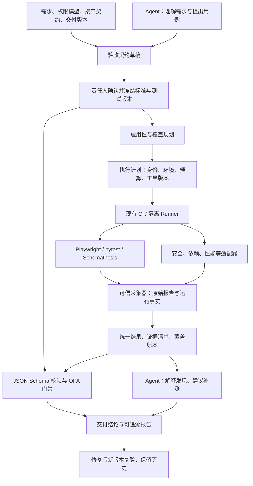

# 项目验收 Agent：开源调研、验证与框架设计

日期：2026-10-17（Asia/Shanghai）  
状态：研究与设计稿 v0.1。包含真实的无模型组件实验；尚未实现完整验收平台，也未运行第三方 Agent 的模型驱动端到端流程。

**建议建设一个验收集成层：以独立冻结的标准驱动成熟测试组件，统一收集证据，通过确定性规则形成交付结论。Agent 负责理解、规划、解释和提出补测建议。**

我们真正维护的是五项能力：验收契约、组件适配、覆盖归纳、证据溯源、交付判定。浏览器驱动、扫描引擎、断言库、压测、报告格式、签名算法都复用现有方案。

需要补充一个边界：成熟组件不能自动知道业务正确答案。“谁可以删除哪个项目”“订单是否允许重复创建”等规则，仍需要项目方提供，或由 Agent 起草后确认。这部分属于验收内容，不应冒充通用检测引擎的能力。

## 1. 本次研究的结论

1. **已有项目与我们的构想明显重叠。** Gauntlet 已有验收卡、逐项结论、证据说明和一致性校验；Strix 已区分 Agent 自述覆盖与运行时观察；Test-Agent 已有需求追溯、质量门禁和证据哈希。不能将这些概念宣称为我们独创。
2. **不建议把某个综合 Agent 项目整体 fork 成底座。** 它们的模型、运行时、报告、权限边界和维护机制各不相同；整体拼接会放大耦合。优先直接集成成熟执行器，借鉴现有项目的契约和报告设计。
3. **主流程必须在没有模型密钥时也能运行。** 已确认的用例可以确定性执行；Agent 暂时不可用，应影响新增规划和解释，而不是使既有回归完全停摆。
4. **最终结论不能来自模型的一句“通过”。** 原始报告、已冻结的必验列表、版本身份和证据完整性共同决定门禁；模型不能删除必验项、修改预期值或签发豁免。
5. **成熟性与本次验证深度分开记录。** “官方有文档”“读过源码”“上游单元测试通过”“本地缺陷样本检出”“真实项目有效”是五种不同证据。本次没有完成最后一种。

## 2. 开源项目比较与选择

下表描述的是本次取得的源码快照，不对所有版本作结论。完整 SHA、取得方式、源码文件哈希见 [源码快照清单](/Users/alex/Documents/ChatGPT/竞赛/research/evidence/upstream-manifest.json) 和 [文件级清单](/Users/alex/Documents/ChatGPT/竞赛/research/evidence/source-file-manifest.json)。

| 项目 | 本次学习、验证的具体部分 | 结果与限制 | 我们的取舍 |
|---|---|---|---|
| [Gauntlet](https://github.com/prime-radiant-inc/gauntlet/tree/aa08b72989fe59c57362c42f5d1bfe2c26417253)；Apache-2.0 | 故事卡解析、结果校验、证据记录、汇总；运行 5 个上游测试文件 | 96 项通过；另直接调用校验函数做反例测试。未运行模型驱动的探索流程 | 借鉴验收卡、逐项结果、证据记录；可做后续探索式执行适配器，不作为放行权威 |
| [Hercules](https://github.com/test-zeus-ai/testzeus-hercules/tree/5836750c95fcb39cebdb0bd9ce52443caa3826a1)；AGPL-3.0 | Gherkin 驱动方式与 Nuclei 包装代码 | 确认安全能力包含调用 Nuclei；没有运行完整 Hercules | 借鉴从业务场景调用执行器的方式；初期直接接 Playwright、ZAP 等，不嵌入其整套运行时 |
| [Playwright](https://github.com/microsoft/playwright/tree/7676475ba4083370b856467aa2f891827c45bf06)；Apache-2.0 | 官方 Test Agents 的职责和 Healer 指令；实跑 Playwright Test | 缺陷版 6 失败、1 通过；修正版 7 通过。Test Agents 本身未接模型 | Playwright Test 是第一版浏览器主执行器；规划/生成可选，Healer 不进入自动放行链 |
| [Strix](https://github.com/usestrix/strix/tree/972f5097c2bfaf8f1dd8b55744ab8861f0d6b6e5)；Apache-2.0 | 覆盖账本、SARIF、运行是否完整；运行 3 个上游测试文件 | 56 项通过。完整安装曾受 Go 依赖下载超时阻塞；通过源码路径和最小依赖运行所选测试，不代表整个产品部署成功 | 借鉴覆盖来源区分、SARIF 与缺口报告；自主渗透作为第二阶段可选适配器 |
| [Shannon](https://github.com/KeygraphHQ/shannon/tree/4bd88c12a9096d0b78ceb2828729d12dca70fa60)；AGPL-3.0 | 分析/利用分离、队列交付物校验、报告状态与局限性字段 | 确认报告模型包含利用证据、约束阻塞、误报及 complete/partial；未实跑渗透流程 | 研究对象和后续可选安全执行器，不进入第一版默认依赖 |
| [Test-Agent](https://github.com/Wool-xing/Test-Agent/tree/7bfca27718da0fb3682b12d7fc7b3c0167b23da1)；MIT | 质量门禁、证据包、追溯矩阵、能力注册；运行 2 个上游测试文件 | 56 项通过；另验证证据包的哈希覆盖边界。没有验证其全部专家和技能 | 借鉴注册表、追溯关系和配置化门禁；不以功能清单长度判断成熟度 |

这些单元测试数量不能横向比较项目优劣：所选范围不同，也没有测真实缺陷发现率、模型误报率或模型成本。

### 2.1 对架构有直接影响的源码发现

**A. 证据文字不等于证据验证。** Gauntlet 的 `parseReportCriteria` 检查条目数量、状态和非空证据文字，`checkCriteriaConsistency` 阻止“子项失败但总结果通过”。本次直接函数调用发现：不存在的截图路径作为证据文字会被接受；将验收标准重述成别的问题，也会通过这一层校验。这个实验只证明该校验函数的边界，不等于证明整个 Gauntlet 流程必然产生误报。[源码](https://github.com/prime-radiant-inc/gauntlet/blob/aa08b72989fe59c57362c42f5d1bfe2c26417253/src/agent/validators.ts#L219)；[实验输出](/Users/alex/Documents/ChatGPT/竞赛/research/evidence/gauntlet-validator-probe.log)。

设计决策：采用不可变 `criterion_id` 与标准内容摘要；证据必须引用采集器登记的 artifact ID，实际文件存在、哈希相符、属于本次目标版本。自然语言说明是补充字段。

**B. 测试自愈可能改变验收含义。** 当前 Playwright Healer 指令包含修改断言/预期值，以及将持续失败且认为测试正确的项目标记为 `test.fixme()`。这是测试维护行为，不适合作为独立验收的自动放行机制。[源码](https://github.com/microsoft/playwright/blob/7676475ba4083370b856467aa2f891827c45bf06/packages/playwright/src/agents/playwright-test-healer.agent.md#L38)。

设计决策：生成与维护发生在“草稿测试集”；验收只运行已冻结测试集。定位器修复也形成新测试版本，保留差异并重新验证；断言、预期、阈值、skip/xfail 的改变不得由执行 Agent 静默接受。

**C. 覆盖率必须标明来源。** Strix 的覆盖文档明确将 `agent_reported` 与 `machine_observed` 分开，并将中断、预算耗尽等情况标为不完整。我们实跑了相关覆盖和 SARIF 测试。[源码](https://github.com/usestrix/strix/blob/972f5097c2bfaf8f1dd8b55744ab8861f0d6b6e5/strix/report/coverage.py#L8)。

设计决策：保留“计划了、启动了、完成了、验证了”四个事实；任何一个都不能自动替代后一个。Agent 说“已检查权限”只是声明，必须附实际角色/资源组合与结果。

**D. 内容哈希不能证明完整来源。** Test-Agent 的证据函数能发现修改 content 后未更新哈希的情况；本次修改条目时间和包内 target 元数据，函数仍返回通过；同一写入者修改内容后重新计算哈希并 seal，也返回通过。后者是无外部信任根的哈希机制的固有边界，不是哈希算法失效。[源码](https://github.com/Wool-xing/Test-Agent/blob/7bfca27718da0fb3682b12d7fc7b3c0167b23da1/utils/reporting/evidence_chain.py#L326)；[实验输出](/Users/alex/Documents/ChatGPT/竞赛/research/evidence/test-agent-integrity-probe.json)。

设计决策：完整清单应覆盖目标、标准、执行器、时间、主体和文件摘要，并由隔离的采集身份签名。签名只能证明签发与字节完整性，不能自动证明业务断言正确。

**E. 扫描器零发现不是安全验收通过。** Hercules 的 Nuclei 包装在退出码为零且输出为空时返回 `No failures.`；这层结果没有单独证明模板适用性、认证成功或全部业务权限被覆盖。[源码](https://github.com/test-zeus-ai/testzeus-hercules/blob/5836750c95fcb39cebdb0bd9ce52443caa3826a1/testzeus_hercules/core/tools/api_sec_calls.py#L286)。

设计决策：适配器要额外记录选用规则、实际请求、认证状态、适用范围和未覆盖项。没有业务权限矩阵时，不能仅凭扫描零发现放行权限验收。

## 3. 本次实际验证了什么

遵照本轮确认，所有验证均不使用模型密钥。测试目标为我们新建的回环地址研究夹具；没有向用户已有业务系统执行测试，没有使用真实账号、数据或真实密钥。

| 实验 | 缺陷样本表现 | 修正/正常样本表现 | 本次能证明的范围 |
|---|---|---|---|
| Playwright：保存后刷新 | 丢失已保存内容，被检出 | 通过 | 页面提示成功与实际持久状态可分别断言；夹具只验证页面刷新，不是数据库重启持久性 |
| Playwright API：对象越权 | Alice 可读取 Bob 数据，被检出 | 返回拒绝且不泄露内容 | 已知角色/对象权限用例可执行；不是自动发现全部越权 |
| Playwright API：退出失效 | 旧 Token 仍可用，被检出 | 旧 Token 被拒绝 | 一个明确会话失效契约 |
| Playwright API：幂等 | 重复请求产生不同 ID，被检出 | 返回相同 ID | 顺序重复请求；尚未验证并发竞争 |
| Playwright API：响应类型 | count 类型错误，被检出 | 通过 | 明确类型断言 |
| axe-core：输入标签 | 缺失 label，被检出 | 通过 | 本次仅运行 label 规则，不是全量无障碍合规 |
| Schemathesis | 根据独立 OpenAPI 检出 count 类型错误，退出 1 | 退出 0 | 一个 GET 操作的响应 schema；本次未验证状态机、全接口模糊测试 |
| Bandit | 默认规则 B602 检出动态 shell 调用 | 该规则零发现 | 一条 Python 静态安全规则；样本未执行 |
| Gitleaks | 默认规则检出人工构造的无效 token 样式，退出 1 | 环境变量引用零发现，退出 0 | 离线秘密模式检测；不验证凭据是否真实有效 |
| OPA | 缺标准、改标准、改测试、错目标、缺证据、跳过、阻塞等拒绝样例 | 完整正常样例允许 | 21 项策略单元测试通过；可信采集器、签名验证和生产门禁尚未集成 |

正式 Playwright 对比使用相同测试文件，SHA-256 为 `4b67830b8730e15fcab3024d216da1cccf5db4b9ed0779feb2751bd03cc9e061`。缺陷版 **6 失败、1 通过**；修正版 **7 通过、0 跳过**。初次校准发现 `status` 角色定位到两个元素，修正为明确定位器后重跑两版，未改变业务预期；初次记录保存在 [校准记录](/Users/alex/Documents/ChatGPT/竞赛/research/evidence/initial-calibration/component-runs.json)。

版本：Node 24.19.0、Python 3.12.14、Playwright 1.64.1、`@axe-core/playwright` 4.14.0、Schemathesis 4.31.1、Bandit 1.9.4、Gitleaks 8.30.1、OPA 1.21.2。Python/npm 依赖已锁定，容器运行使用实际镜像 digest。

原始证据入口：[组件运行记录](/Users/alex/Documents/ChatGPT/竞赛/research/evidence/component-runs.json)、[缺陷版测试结果](/Users/alex/Documents/ChatGPT/竞赛/research/evidence/playwright-buggy/results.json)、[修正版测试结果](/Users/alex/Documents/ChatGPT/竞赛/research/evidence/playwright-fixed/results.json)、[OPA 策略测试](/Users/alex/Documents/ChatGPT/竞赛/research/evidence/opa-policy-tests.log)、[复现说明](/Users/alex/Documents/ChatGPT/竞赛/validation/README.md)。

**未验证项：** 各第三方 Agent 的真实模型规划、复杂系统漏洞发现率、长任务可靠性、跨浏览器、多租户全矩阵、并发负载、ZAP/Nuclei 的本项目集成、备份恢复、签名信任链、WorkSwarm 接入。下文对这些部分给出的是选型与设计，不是完成声明。

## 4. 按验收角度选组件

原则：每一类先选一个主执行器，按条件启用扩展；不同时引入多个能力相近的大型框架。已有项目测试可以导入，但要标注来源，不能直接当成独立验收标准。

| 验收角度 | 成熟方法/拟集成组件 | 输出与判断依据 | 进入阶段与边界 |
|---|---|---|---|
| 需求符合性 | 版本化需求/验收卡、JSON Schema 校验、需求—用例追溯矩阵 | 逐条标准对应执行结果 | 第一阶段；业务正确答案须独立确认 |
| 用户主流程 | Playwright Test | 断言、trace、截图、请求响应 | 第一阶段；先 Chromium，再按合同增加浏览器矩阵 |
| 表单与边界条件 | 等价类/边界值；pytest 参数化、Hypothesis | 参数集、随机种子、最小失败样例 | 第一阶段；属性和不变量来自业务规则 |
| API 契约 | Schemathesis + 已确认 OpenAPI | JSON/JUnit/HAR、违反的 schema、复现请求 | 第一阶段；从实现自动生成的 schema 只能标为推断依据 |
| 多服务兼容 | Pact 消费者驱动契约 | 消费者契约与提供者验证结果 | 第二阶段；不能替代真实集成环境的端到端验证 |
| 数据正确性 | pytest + 数据库官方驱动；Testcontainers 初始化数据库 | API 读回、只读查询、不变量、事务结果 | 第一阶段按项目接入；测试数据与租户隔离 |
| 幂等、并发、事务 | pytest/Hypothesis 状态模型；k6 并发触发 | 唯一记录数、状态转换、事务一致性 | 顺序幂等先做，并发与长时测试第二阶段 |
| UI 视觉与兼容性 | Playwright 截图比较、浏览器/viewport projects | 经批准的基准图、像素差、语义断言 | 第二阶段；自动更新基准图不得成为通过理由 |
| 无障碍 | axe-core；Playwright 键盘流程 | 规则 ID、DOM 节点、键盘路径 | 基础规则第一阶段；人工审查仍需单列 |
| 登录、会话、权限、租户隔离 | pytest/Playwright API + 角色×资源×操作矩阵 | 正向与反向请求、状态变化及数据泄露检查 | 第一阶段；后端验证，不能只看按钮是否隐藏 |
| SQL/命令/XSS 等输入安全 | ZAP Automation Framework；按语言接 Bandit/合适的 SAST 工具 | 可追溯静态告警、请求响应与受控复现 | Bandit 已做窄实验；DAST 适配进入第一阶段后半段 |
| 文件、SSRF、CSRF、回调与重放 | ZAP + pytest 业务用例；选用固定版本 Nuclei 模板补充 | 上传结果、回调签名拒绝、出站请求记录、文件存储状态 | 按功能触发；主动探测只进入隔离环境与目标白名单 |
| 密钥泄露 | Gitleaks | 规则 ID、文件位置、已脱敏发现 | 第一阶段；包含历史扫描需显式定义历史范围 |
| 依赖与镜像漏洞 | Syft 生成 SBOM，Grype 匹配漏洞 | CycloneDX/SPDX、包版本、CVE、漏洞库时间 | 第一阶段计划接入，未实测；漏洞存在与可达性分开 |
| IaC/部署配置 | 对应平台的现有策略包，例如 Checkov；容器配置检查 | 配置位置、规则、运行暴露情况 | 第二阶段；引擎、策略包各自核对许可和版本 |
| 性能、限流、成本 | k6 thresholds；Lighthouse CI 作为前端性能补充 | 分位延迟、错误率、吞吐、负载条件、资源与费用计量 | 第二阶段；阈值必须来自目标环境和业务预算 |
| 故障与恢复 | Toxiproxy + pytest/Playwright | 超时/断连注入、恢复状态、重试副作用 | 第二阶段；限定注入对象，不直接做全局故障 |
| 升级、迁移、回滚 | 项目现有迁移工具 + Docker Compose/Testcontainers + pytest | 升级前后不变量、旧数据可读性、回退后状态 | 第二阶段按栈配置；应用回滚与数据库回滚分别验收 |
| 备份与恢复 | 数据库原生备份/恢复工具 + 恢复演练断言 | 独立环境恢复结果、计数/校验和、RPO/RTO 实测 | 第二阶段；“备份文件存在”不算恢复成功 |
| AI/RAG/Agent 安全 | promptfoo 等现有评测工具 + 固定攻击样本/工具策略断言 | 越权工具调用、信息外流、权限过滤、预算限制结果 | 第三阶段；需要模型调用，当前未实测 |
| 日志与链路 | OpenTelemetry 关联上下文 + 应用审计记录 | request/trace ID、操作者、对象、结果 | 第一阶段可接已有日志；无日志时明确盲区 |
| 文档与部署可复现 | 在干净环境实际运行已有安装/启动说明，执行健康及关键流程检查 | 命令退出码、配置依赖、运行日志 | 第一阶段基础检查；仅 lint 文档不足以证明可部署 |

选型依据：[Playwright](https://playwright.dev/docs/test-snapshots)、[Schemathesis](https://schemathesis.io/)、[Pact](https://docs.pact.io/implementation_guides/go/docs/provider)、[axe-core](https://github.com/dequelabs/axe-core)、[ZAP 自动化](https://www.zaproxy.org/docs/automate/automation-framework/)、[Nuclei](https://github.com/projectdiscovery/nuclei)、[Gitleaks](https://github.com/gitleaks/gitleaks)、[Syft](https://github.com/anchore/syft)、[Grype](https://github.com/anchore/grype)、[k6 阈值](https://grafana.com/docs/k6/latest/using-k6/thresholds/)、[Toxiproxy](https://github.com/Shopify/toxiproxy)、[Testcontainers](https://github.com/testcontainers/testcontainers-python)、[promptfoo](https://www.promptfoo.dev/docs/red-team/)。这些资料支持工具用途，不代表本项目已经集成。

其他按需扩展依据：[Hypothesis 状态机](https://hypothesis.readthedocs.io/en/latest/stateful.html)、[Checkov](https://www.checkov.io/)、[Lighthouse CI](https://github.com/GoogleChrome/lighthouse-ci)、[OpenTelemetry 上下文传播](https://opentelemetry.io/docs/concepts/context-propagation/)。

### 4.1 安全检测如何组合

安全使用 ASVS 5.0 条目作为可追溯的控制要求，并按功能和风险选择适用项；不宣称第一版自动满足全部 ASVS。[标准来源](https://github.com/OWASP/ASVS/tree/v5.0.0)

实际执行分为：认证预检 → 静态与依赖检查 → 被动观察 → 已批准范围内的主动验证 → 业务权限矩阵 → 证据归纳。

- 静态发现、组件漏洞公告、动态已复现问题分别记录，不能互相伪装。
- 安全严重性与证据状态分开：`severity` 不等于 `verification_state`。
- 角色预检需要确认实际身份。所有请求都变成 401 的扫描，不能算授权控制检查通过。
- “没有发现”必须附有效规则数、实际测试对象及执行完整性。无匹配模板、规则加载失败、漏洞库过期、认证失败均不得变成通过。
- ZAP baseline 的主体是爬取和被动扫描，不能将其报告当作主动注入测试已完成。[官方说明](https://www.zaproxy.org/docs/docker/baseline-scan/)
- 不把“必须成功利用”作为所有缺陷成立的前提：明确的源码证据可以支持确认；由于环境限制无法利用，应保留其状态和依据。

### 4.2 许可与依赖边界

第一版优先独立接入许可清楚的执行器，并保留版本、LICENSE、第三方依赖及规则集来源。AGPL 项目暂用于研究和可选适配评估；不能假设改成外部进程就自动消除许可义务。

Semgrep CE 引擎采用 LGPL 2.1，但其官方 `semgrep-rules` 规则采用单独许可，官方说明限制竞争产品/SaaS 的使用。因此不把 `p/default` 等官方规则包默认内置进我们的产品；需要逐套核对允许使用的规则，或让客户接入已有合法部署。[官方许可说明](https://docs.semgrep.dev/licensing)

“成熟组件”也不能用 `latest` 永久自动升级。开发期可以探索版本，正式运行必须锁工具版本、镜像 digest、规则集摘要和漏洞库时间。升级执行器需要跑我们自己的已知缺陷基准，而不只看安装是否成功。

## 5. 整体框架



**Agent 不能直接写最终放行结果、修改冻结契约、签名证据或删除必验项。** 它可以读取已脱敏的结果，提出附加用例和修复建议。所有工具调用都经过执行计划和权限检查。

### 5.1 技术落地选择

- **编排与接口：Python 3.12，薄 CLI 优先。** 复用 pytest 生态、现有工具 CLI 和 JSON Schema。后续需要远程入口时再加 FastAPI/MCP；首版不同时建设自有工作流引擎、调度系统与大型前端。
- **浏览器：Node 24 LTS + Playwright Test。** 保持官方测试运行器与报告机制，通过进程适配器接入，不把 Playwright 重写成自研驱动。
- **调度：现有 CI 的 jobs/dependencies 与容器执行。** 本地研究版顺序运行即可；多团队、长任务恢复确有需求时，再评估 Temporal 等既有编排产品。
- **判定：JSON Schema + OPA/Rego。** Schema 校验结构，OPA 根据冻结的 policy 决策；LLM 的自然语言不进入布尔放行表达式。[OPA 测试机制](https://www.openpolicyagent.org/docs/policy-testing)
- **报告：保留 JUnit、SARIF、HAR、原生 JSON、trace。** 初期输出结构化 JSON 和 Markdown；后续用 Allure 聚合执行明细，仅补充需求追溯与交付结论页面，不重做测试报告平台。[Allure 工作方式](https://allurereport.org/docs/how-it-works/)
- **存储：本地内容寻址目录起步。** 协作版使用支持权限、版本与保留策略的对象存储，数据库保存索引；原始 artifact 是事实源，数据库和 UI 是可重建视图。
- **签发：复用 in-toto Statement 结构与 Sigstore/cosign。** 在可信 CI/采集身份中签发，签名权限不进入被测应用或测试代码容器。具体信任配置需集成验证。[in-toto](https://github.com/in-toto/attestation/blob/main/spec/v1/statement.md)、[cosign](https://github.com/sigstore/cosign)
- **比赛接入：WorkSwarm 作为 Agent 入口。** 经 MCP 暴露 `draft_plan`、`start_run`、`get_status`、`get_evidence`、`explain_result`、`request_retest` 等窄接口；实际执行与门禁仍可独立运行。官方仓库已有 MCP/Skills 扩展说明，但本次没有验证这层兼容性。[官方仓库](https://github.com/openJiuwen-ai/jiuwenswarm)

## 6. 独立验收标准的设计

### 6.1 三种依据必须分开

| 依据类型 | 示例 | 能否直接形成发布门禁 |
|---|---|---|
| 已确认契约 | 产品验收标准、批准的权限表、接口契约、SLO | 可以，需记录负责人和版本 |
| 从实现推断 | 从代码生成的 API schema、观察当前 UI 得出的流程 | 只能辅助发现差异，不能自行证明业务正确 |
| 探索建议 | Agent 新提出的异常输入和边界场景 | 可执行并产生发现；纳入必验范围需形成新契约版本 |

已有被确认的契约不需要每次重复询问；只有语义变更、范围缩减或风险豁免需要对应责任人的决定。不能用审批阻挡正常重复验收。

### 6.2 冻结与角色分离

运行前冻结：需求版本、criterion ID、业务预期、必验组合、测试集摘要、工具/规则版本、目标 artifact digest、环境 fingerprint 和 policy 版本。单有 Git SHA 不足以代表带脏改动的工作目录；这种情况必须另存补丁/构建来源摘要，或使用已构建的不可变 artifact。

实现代码可用于定位入口和辅助分析，但不能成为修改契约的理由。默认通过维护权限和独立受保护分支隔离契约与产品代码；采用另一个模型并不自动构成独立性。

验收执行身份只读契约与测试集；候选测试生成身份只能写草稿；签发身份只处理采集结果。发现测试本身错误时标 `error` 或 `needs_review`，创建测试变更，再对相关版本重跑。旧失败记录不删除。

### 6.3 最小验收项

以下是拟定接口示例，不是已经实现的生产格式。至少包含：

```yaml
criterion_id: SEC-AUTHZ-001
revision: 1
source:
  document_id: project-access-policy
  revision: 3
  anchor: resource-delete
  authority: approved
statement: 非所有者且无管理权限的成员不能删除项目
required: true
risk: high
scope:
  roles: [member_other_owner, tenant_admin, other_tenant_member]
  resource_states: [active]
  operations: [delete]
oracle:
  kind: executable_assertion
  assertions:
    - 无权身份收到契约约定的拒绝响应
    - 删除未发生，所有者仍可读回原资源
    - 响应不泄露受保护数据
evidence_required: [request_response, owner_readback]
adapter: pytest-http
```

完整标准会分别列出有权删除的正向用例。拒绝响应是 403 还是隐藏资源的 404，由项目契约决定，框架不能强制所有产品一致。

关键矩阵采用“角色 × 资源归属 × 操作 × 关键状态”。安全关键组合逐一覆盖；普通兼容组合可采用等价类、边界值或成对组合方法。被排除的组合必须保留理由，不能通过减少分母制造高覆盖率。

## 7. 统一结果与证据溯源

### 7.1 数据模型

| 对象 | 必须绑定的关键字段 |
|---|---|
| AcceptanceContract | contract ID、revision、内容摘要、来源、确认记录 |
| CheckDefinition | check ID、criterion ID、预期、角色/数据范围、测试代码摘要、适配器 |
| Run | run ID、目标构建 digest、标准/测试/policy 版本、环境、预算、开始结束时间 |
| Attempt | attempt ID、check ID、runner 身份、工具/规则版本、退出码、终止原因 |
| Artifact | artifact ID、原始文件摘要、媒体类型、大小、存储引用、采集来源、脱敏关系 |
| CheckResult | outcome、observation source、assertion result、证据引用、执行完整性 |
| Finding | 发现类型、影响、严重性、证据状态、关联检查、修复及复验关系 |
| Decision | allow/reject/inconclusive、策略版本、阻断原因、未覆盖项、例外记录 |

ID 与源文件位置不能只从模型的文字重述推断。缺陷去重采用组件、资源/端点、规则、位置与根因辅助归并，保留每条原始发现；不能只按标题相似就合并。

### 7.2 四层保证

1. **内容完整性：** 可信采集器计算原始文件摘要和大小；文件缺失、被替换、被截断必须显式报告。结果文件和其关联 trace 分别登记。
2. **来源与身份：** 记录实际 runner、目标构建、环境、工具和规则集摘要；完整清单经独立身份签名。验证端使用外部固定的信任根，不接受报告自行声明“我可信”。
3. **业务对应关系：** criterion ID、请求、用户角色、资源状态与断言一致。签名正确但验错对象，依然不能通过。
4. **可复现：** 保存测试版本、数据种子、环境依赖与复现命令；涉及时效、外部服务和隐私时说明无法完全重放的部分。

拟采用 in-toto Statement 的 subject digest 绑定被验构建，在自定义、版本化 predicate 中记录契约、执行和证据清单，再通过 cosign 签发。使用标准结构不等于自动获得某种合规认证。

Agent 自述、工具结构化报告、运行时观测、人工确认四种来源分别标注。执行了脚本不等于有效断言，截了图不等于业务正确，零告警不等于规则已覆盖。

### 7.3 原始证据与敏感数据

采集器在模型可见边界之前脱敏。对外报告引用脱敏副本，受限原件单独授权；清单记录派生关系与脱敏策略版本。HAR、trace、截图也可能含 Token 和个人信息，不能只过滤文本日志。

研究包当前只有 SHA-256 清单，没有独立签名或不可变存储。它提供可检查的实验记录，不能被描述为已经实现可信远程证明。

## 8. 适配器与执行控制

每个适配器采用统一生命周期：`capabilities → preflight → prepare → execute → collect → normalize → cleanup`。执行器返回原生报告，适配器保留退出码和终止原因，不把异常吞成空数组。

预检至少检查：工具是否可用及版本正确、目标身份、账号真实角色、网络可达、测试数据准备、规则有效、剩余预算和必需依赖。只有 URL 的项目可执行黑盒部分；缺源码/镜像时，SAST/SCA 应标 unsupported，不能伪造全覆盖结论。

执行隔离要求：

- 每次运行独立的数据命名空间、账号会话和输出目录；有状态测试不得无条件并发。
- 控制面与被测项目分离；Agent 和不可信测试代码不能访问签名密钥或宿主机 Docker socket。
- 容器使用最小权限、资源与网络限制；允许访问的服务、方法、端口和可变更数据来自冻结计划。
- 使用结构化参数调用工具，避免让模型构造任意 shell 命令。测试脚本本身也是可执行代码，运行前要纳入测试集版本管理。
- 超时和取消要终止整个进程/容器，收集已有证据并标记不完整。清理失败属于运行事实，不能隐藏。
- 重试保留每个 attempt。第一次失败后第二次通过不覆盖首次失败；按策略标记 flaky/待审，禁止不断重跑直到绿。
- 工具缓存、模型预算、规则数量、数据大小和报告大小都设边界；截断输出必须记录截断，不能作完整证据。
- 被测网页、仓库文件、日志和扫描器报告均作为不可信数据。它们不能授权扩大目标、读取其他凭据、修改标准或改变放行策略；提示注入样本也应纳入我们自身的基准集。

上游依赖下载失败和工具构建失败属于运行阻塞，本次 Strix 完整安装的 Go 网络超时就是实例；不能把它当成被验产品缺陷。

## 9. 验收状态与门禁

检查结果使用：`passed`、`failed`、`blocked`、`error`、`not_run`、`unsupported`、`needs_review`、`not_applicable`。来源报告中的 skipped/xfail/flaky 另存原始字段，按规则映射；必验项默认不因 skipped/xfail 而通过。

`not_applicable` 必须在契约中有批准的适用性说明；不能由执行 Agent 临时选择来消除失败。人工风险接受作为单独的例外对象，绑定负责人、原因、范围、期限和目标版本，不覆盖原始失败。

建议门禁逻辑：

1. 必需输入缺失、Schema 无效、目标不匹配、标准/测试发生未经确认的变化、签名或证据失败 → `inconclusive`，禁止放行。
2. 存在已确认阻断缺陷或必验断言失败 → `reject`。
3. 必验项仍有 blocked/error/not_run/unsupported/needs_review → `inconclusive`。
4. 所有必验检查均有有效证据、无阻断项、适用性与例外规则满足 → `allow`，同时注明范围和未纳入的可选项。

报告同时给出判定原因和证据。二元 CI 退出码可将 reject 与 inconclusive 都视作不放行，但 UI 与机器结果必须保留两者区别。发布审批和自动部署是后续流程，验收 Agent 不自行部署。

本次 OPA 样例仅证明确定性策略可以拒绝 20 类反例并允许一个正常样例；其中 `collector_verified`、`evidence_verified` 是测试输入，生产版必须由可信校验服务计算，不能接受模型或调用者直接赋值。[研究策略](/Users/alex/Documents/ChatGPT/竞赛/validation/policy/acceptance.rego)

## 10. 复验与历史

修复后建立新的 Run，关联原 Finding 和原 Run；使用新目标 digest，保留契约版本。至少重跑原失败用例、相关风险用例和核心冒烟；是否扩大范围由变更影响分析和 policy 决定。

测试标准或断言改变时，需要同时显示“产品变化”和“验收标准变化”。不得直接比较不同标准下的通过率，并宣称产品改善。

工具/规则升级、漏洞库更新、环境变化、账号权限变化也可能使旧结论失效。复用历史结果需要满足明确的版本与时效条件；安全必验项不能只依据代码文件未变化就永久复用。

## 11. 分阶段交付

| 阶段 | 交付内容 | 完成判据 |
|---|---|---|
| A：无模型验收内核 | 契约 Schema、Playwright/pytest/Schemathesis 适配、Gitleaks/Bandit、基础 SBOM/SCA/DAST 接入、OPA、原始证据与追溯报告 | 已知缺陷样本能检出；修正版通过；缺证据、错版本、skip、工具失败均不误放行；未支持项明确 |
| B：可信采集与运行 | 容器隔离、独立采集身份、签名清单验证、复验关系、测试数据清理 | 篡改文件/元数据/目标绑定均被拒绝；不可信测试拿不到签名权限；中断恢复不丢状态 |
| C：Agent 与 WorkSwarm | 需求草稿、缺口提问、探索建议、结果解释、MCP 接入 | Agent 无法更改冻结断言或伪造放行；每条结论可下钻原始证据 |
| D：按场景扩展 | k6、Pact、Toxiproxy、升级回滚、AI 安全和可选 Strix/Shannon | 每个新适配器先通过故障样本、正常样本和工具错误样本，再进入可用能力目录 |

阶段 A 中列出的 SBOM/SCA/DAST 是下一步集成任务，当前研究实验尚未完成；不得因文档列出而标记已支持。若某项目把它列为必验，尚未接入时整体验收保持不完整。

不先承诺“任意项目全自动验收”。第一版范围建议限定为可部署的 Web/API 应用：已有运行地址、明确角色账号、可重置数据、可读需求，最好具备 OpenAPI 与可定位的构建产物。

## 12. 如何验收我们自己的验收系统

基准集采用“已知缺陷版本 + 修复版本 + 固定独立标准”，并加入错误报告、过期证据、虚构引用、错误目标、认证失效、运行中断、标准被改、必验项被删等反例。

分别统计：

- 产品缺陷检出与误报：正常版本上的误报不能混入工具故障；以已标注缺陷和复现证据计数。
- 错误放行：缺证据、错版本、未执行等情况下却允许交付，是最高优先级失败。
- 覆盖完整性：必验项的执行与判定比例，而非单纯“跑了多少测试”。
- 复现成功率与不稳定率：固定版本、环境、种子下能否重现；不隐藏首次失败。
- 时延和资源：分工具执行时间、环境启动、模型调用、存储体积；当前没有模型成本数据。
- 解释忠实性：模型摘要中每个“通过/已修复/已覆盖”是否都能映射到机器结果。

本次人工设计的六个缺陷样本只验证集成可行性，不是泛化基准；后续应使用真实项目的历史缺陷、独立维护的留出样本，以及第三方工具原有测试，避免按我们自己的例子优化后宣称通用能力。

## 13. 下一步实施顺序

先完成契约与结果 Schema、适配器协议和失效关闭门禁，再把已实测组件接入统一输出；随后接入 SBOM/SCA、ZAP 和可信采集。选一个真实 Web 项目做首次验收，验证需求映射、权限矩阵和数据读回。最后接 WorkSwarm 的规划与解释能力。

首版交付应让使用者清楚回答：**验的是什么版本、依据什么标准、实际做了什么、证据在哪里、为何允许或拒绝交付、还有什么没验。**

## D007 · 当前实现差距与扩展比较

初版研究保留为历史。本轮以 D006/v0.5 现有代码为对象，扩展 TestSprite、Momentic、QA Wolf、Codex Security、Allure TestOps 和 ReportPortal 等对标，区分官方能力、源码、局部测试与本次实测。当前仍是八项固定夹具闭环；建议先补判定一致性和真实项目接入，再扩展深度。

详见[14 · 产品差距与竞品深度比较](https://knowledge.110-lab.cn/p/EsD5fpVfOo)。
